# AI Research Assistant

A comprehensive Django-based web application that serves as an AI-powered research assistant for academic papers. The application integrates with the OpenAlex API to search, retrieve, and process academic paper metadata, and uses an LLM to generate individual paper summaries with proper academic citations. The LLM is chosen by configuration: OpenRouter's free models, a self-hosted Ollama server on a university research server, or Ollama with OpenRouter as a fallback. Searches can also try a local corpus on that research server before OpenAlex.

## Features

### Core Functionality

- **OpenAlex API Integration**: Full integration with OpenAlex API using pyalex library
- **Selectable LLM Backend**: `LLM_BACKEND` chooses `openrouter` (default), `ollama`, or `ollama_then_openrouter`. The last tries Ollama first and falls back to OpenRouter on any failure. Summaries, titles and Q&A all go through the same backend
- **OpenRouter LLM Integration**: Uses free models from OpenRouter to generate individual paper summaries with intelligent fallback
- **Local Corpus Search**: When `RESEARCH_API_URL` and `RESEARCH_API_KEY` are set, first-page searches ask the university research server for papers before OpenAlex. A weak or failed result falls back to OpenAlex. Responses report their origin in a `source` field (`local` or `openalex`). The local corpus is skipped (OpenAlex only) for Load More, open-access-only searches, and any real year filter; the default 1900-2026 range does not count as a filter
- **Live Free-Model Discovery**: The free-model list is fetched from OpenRouter's `/models` API and cached (6 hours by default), so there is no hardcoded model list to keep up to date. Non-chat models (classifiers, embedders, guardrails) are excluded using OpenRouter's own `supported_parameters` / `output_modalities` fields
- **Performance Tracking System**: Comprehensive monitoring of model performance with reliability scoring
- **Intelligent Model Selection**: Automatic fallback to best-performing models based on success rates and response times
- **Paper Search Service**: Search academic papers with advanced filtering options (year range, open access status, random sampling)
- **Author Search Service**: Search for academic authors via OpenAlex API
- **Metadata Extraction**: Comprehensive extraction of paper metadata including title, authors, abstract, publication year, DOI, research concepts, and open access information
- **LLM Summarization**: Generate individual summaries for each paper with Harvard-style citations and 90%+ format compliance
- **PDF-to-Markdown Extraction**: Converts open-access PDFs to page-tagged Markdown (PyMuPDF4LLM), cached per paper so repeat questions skip re-downloading and re-OCRing
- **Multi-Paper Q&A with Verified Citations**: Ask questions across up to 10 selected papers at once; every citation is checked deterministically against the source page text (page existence + fuzzy snippet match) before being shown as verified
- **Clerk Authentication**: Google sign-in via Clerk gates the workspace and analysis pages; the API validates the Clerk JWT server-side. Only `/api/` and `/api/search/` are open to signed-out visitors; the LLM and PDF endpoints require a valid token (`/api/summarise/`, `/api/generate_title/`, `/api/multi-paper-qa/`, `/api/openalex/authors/` and `/api/performance/*`)
- **Cursor-based Pagination**: Efficient pagination for large result sets using OpenAlex cursor API. Load More needs `OPENALEX_API_KEY`; without it OpenAlex rejects cursor paging with a 401 (a startup warning is logged)
- **Circuit Breaker Pattern**: Models are automatically disabled after consecutive failures, tried last while disabled, and re-enabled 30 minutes after their last failure (or on their next success)
- **Real-time Analytics**: Admin dashboard with dedicated performance monitoring interface

## Architecture

The diagram shows how a request moves through the app. Solid arrows are normal calls; labelled arrows are fallbacks or conditions.

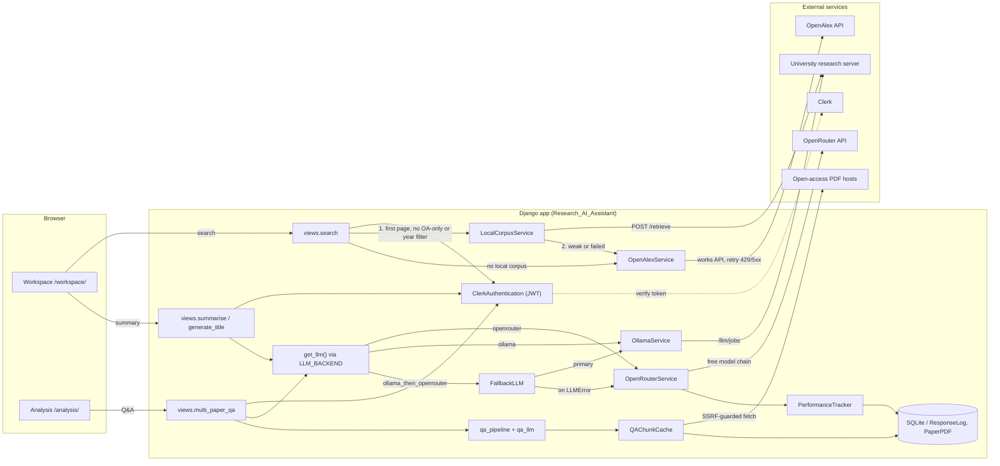

## Performance Tracking System

The application includes a performance tracking system for OpenRouter models. Calls served by the Ollama backend are not recorded in it, so they do not appear on the dashboard:

### Key Features

- **Reliability Scoring**: Dynamic scoring (0.0-1.0) based on success rate, response time, recent activity, consecutive failures, and **format compliance (30% weight)**
- **Intelligent Fallback**: Models automatically tried in performance order, not randomly
- **Circuit Breaker Pattern**: Failing models are disabled after a configurable number of consecutive failures (default 5), sorted behind every active model (kept as a last-resort fallback), and automatically retried once 30 minutes have passed since their last failure. A model switched off by hand in the admin ("Deactivate selected models") stays off
- **Real-time Monitoring**: Live dashboard with colored metrics and error analysis
- **Model Tiers**: Configurable tiers (Primary, Secondary, Emergency, Disabled)
- **Request Logging**: Detailed logging of every API request with error tracking
- **Format Compliance Tracking**: Automatic validation of required fields (Authors:, Year:, Source:, DOI:, Summary:, References:)

### Performance Metrics

- **Success Rate**: Percentage of successful requests per model
- **Response Time**: Average response time in milliseconds
- **Consecutive Failures**: Track failure streaks for circuit breaker
- **Reliability Score**: Weighted score combining multiple factors including **format compliance (30% weight)**
- **Format Compliance Score**: Percentage of responses that include all required fields
- **Error Analysis**: Common failure patterns and error messages

### Performance Dashboard

A dedicated admin interface for real-time monitoring of AI model performance:

- **Web Interface**: Accessible at `/performance/`
- **Live Statistics**: Total models, active models, tier categories, and recent activities
- **Top Performing Models**: Real-time ranking with reliability scores and response times
- **Recent Activity Log**: Success/failure tracking with timestamps
- **Tier Distribution**: Visual representation of model performance tiers
- **Auto-refresh**: Data automatically refreshes every 30 seconds
- **Modern UI**: Responsive design with dark theme and intuitive navigation

### Format Compliance System

The system automatically validates every LLM response for required academic formatting:

- **Required Fields**: `Authors:`, `Year:`, `Source:`, `DOI:`, `Summary:`, `References:`
- **Automatic Validation**: Built into performance tracker, runs on every successful request
- **Cumulative Scoring**: Tracks pass/fail rates over time
- **Database Integration**: Format compliance scores stored and used for model selection
- **Real-time Updates**: Admin panel shows live format compliance metrics

### Top Performing Models

Free models come and go, so no ranking is hardcoded here. The live ranking (reliability score, success rate, format compliance, response time) is built from your own request history and shown on the performance dashboard at `/performance/`, or via `python manage.py initialize_models`, which prints the top models by reliability and by format compliance.

### Frontend Features

- **Landing Page**: Dedicated marketing/entry page at `/`, separate from the workspace
- **Modern UI**: Clean, responsive web interface with dark theme
- **Interactive Research View**: Dynamic chat-like interface for research conversations
- **Paper Analysis Page**: Select papers from a search, view them side-by-side, and run multi-paper Q&A with page-level, verified citations shown per answer. Papers with no PDF or open-access link (including every paper from the local research-server corpus) are shown but excluded from Q&A
- **Binder System**: Save and organize research conversations with custom colors and titles
- **Paper Cards**: Visual display of research papers with metadata and links
- **Load More Functionality**: Seamless pagination for browsing large result sets
- **Real-time Search**: Instant search with loading indicators and error handling
- **Year Filter**: Single slider to filter papers by publication year (1900-2026)
- **Dynamic Tooltip**: Interactive year display when adjusting the filter

## Interface Screenshots

### Main Interface

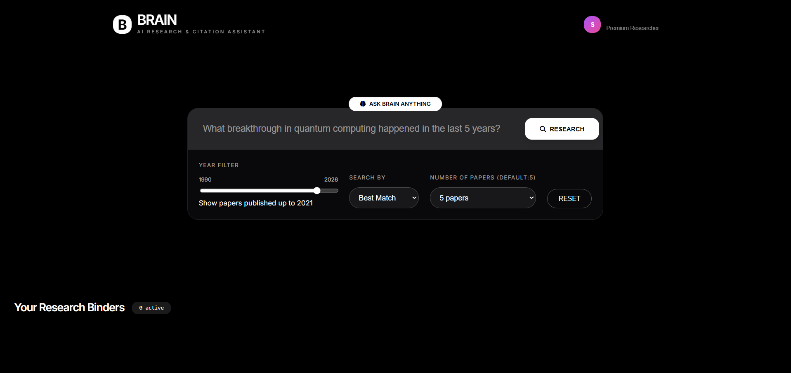

### Year Filter Selection

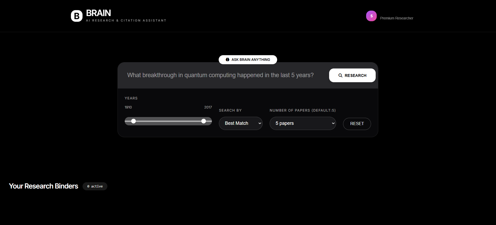

### Filter Options

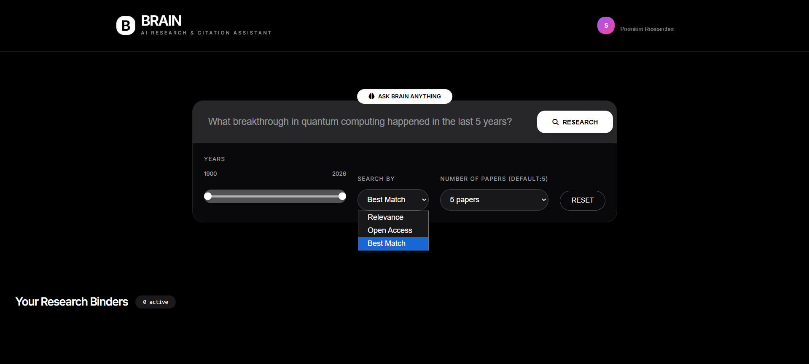

### Filter Number of Papers Selection

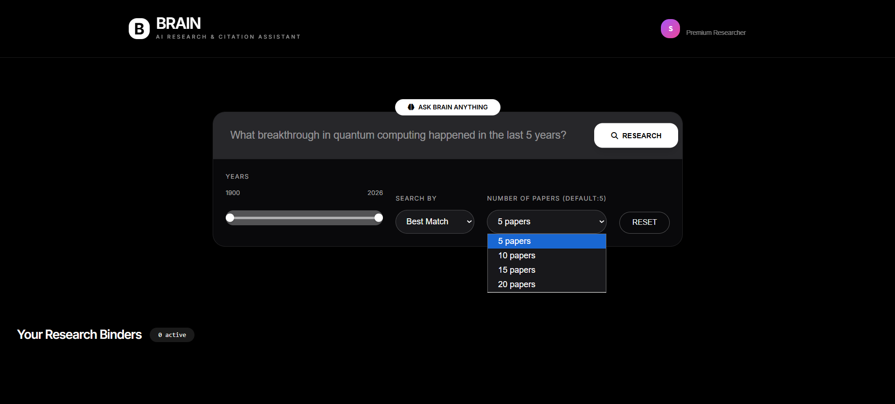

### Research Response View

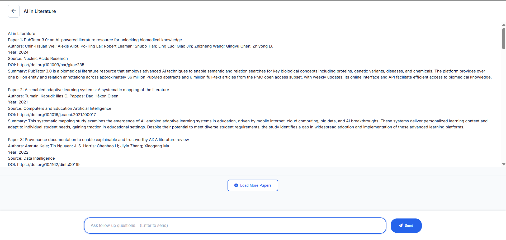

### Response Page Filter By Relevance for References

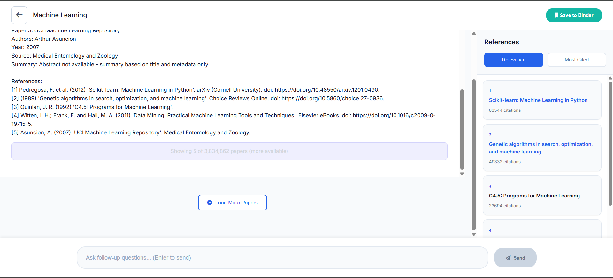

### Response Page Filter by Most Cited

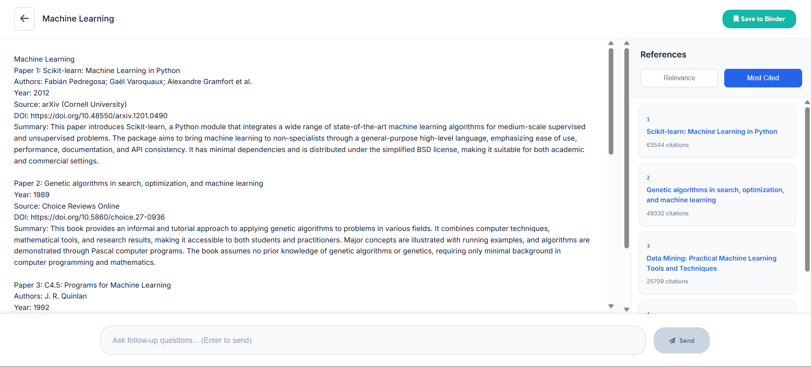

### Binder saving of the response page

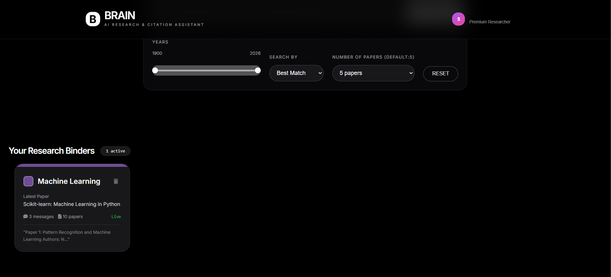

### Binder delete of the response page

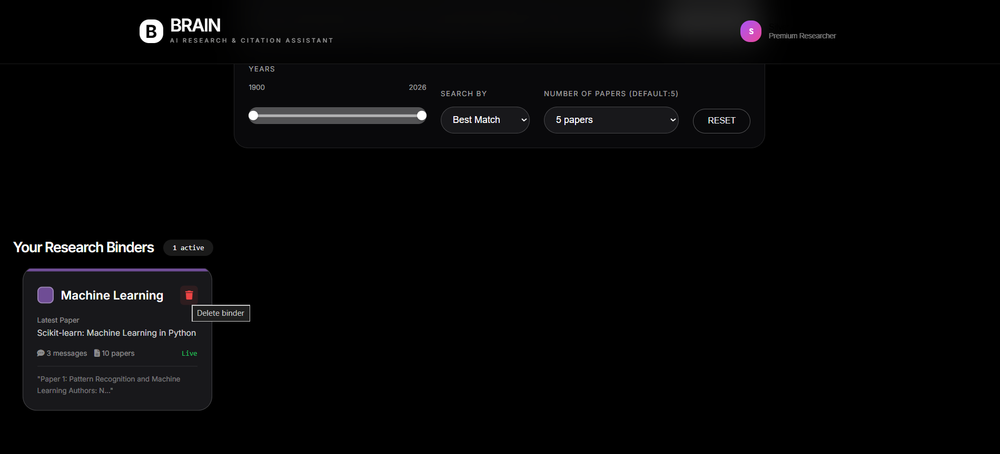

### Performance Dashboard

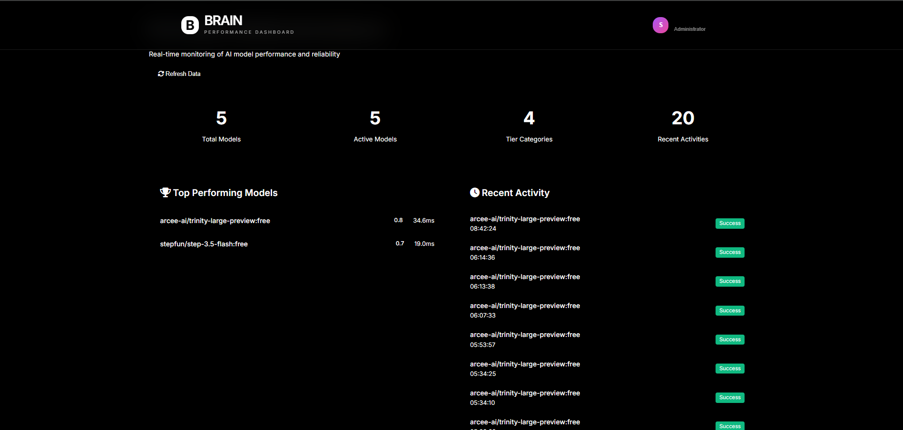

## Technology Stack

### Backend

- **Framework**: Django 6.1+ (below 7), Django REST Framework 3.18+ (below 4)
- **API Client**: pyalex (OpenAlex Python client)
- **LLM Provider**: Selectable via `LLM_BACKEND`: OpenRouter (free models with intelligent fallback), a self-hosted Ollama server, or Ollama with OpenRouter fallback
- **Database**: SQLite (development), PostgreSQL (production ready)
- **Environment Management**: django-environ
- **Performance Monitoring**: Custom performance tracking system with reliability scoring
- **Model Management**: Circuit breaker pattern and intelligent model selection

### Frontend

- **Template Engine**: Django Templates
- **CSS Framework**: Vanilla CSS
- **Icons**: FontAwesome 6.6.0
- **JavaScript**: Vanilla JavaScript with modern ES6+ features
- **Architecture**: Component-based with DOM management

### External APIs

- **OpenAlex**: Academic paper metadata and citation data
- **OpenRouter**: LLM models for paper summarization, titles and Q&A (when the backend uses OpenRouter)
- **University research server**: Optional local paper corpus (`POST /retrieve`) and Ollama LLM endpoints (`/llm/jobs`, `/llm`), both authenticated with `RESEARCH_API_KEY`
- **Clerk**: Sign-in and JWT verification for the workspace, analysis page and authenticated API

## Project Structure

```
AIResearchAssistant/
├── README.md                           # This file
├── requirements.txt                    # Python dependencies
└── Research_Assistant/                 # Main Django project
    ├── manage.py                       # Django management script
    ├── summarise.py                    # LLM summarization test script
    ├── Test/                           # Test modules (see Testing; not all run by `manage.py test`)
    │   ├── test_llm_service.py         # Offline: Ollama client, FallbackLLM, get_llm()
    │   ├── test_local_corpus.py        # Offline: research-server search client
    │   ├── test_openalex_service.py    # Offline: OpenAlex retry behaviour
    │   ├── test_integration_flow.py    # Offline: search and summarise fallback chains
    │   ├── test_qa_services.py         # Offline unittest for the Q&A / PDF services
    │   ├── test_openrouter.py, test_performance.py, test_consistency.py,
    │   │   test_format_validation.py, quick_consistency_test.py, test_api.py
    ├── .env                            # Environment variables (create this)
    ├── Research_Assistant/             # Django project config
    │   ├── settings.py                 # Django settings
    │   └── urls.py                     # Root URL configuration
    └── Research_AI_Assistant/          # Main Django app
        ├── models.py                    # Database models (incl. PaperPDF cache, custom User)
        ├── serializers.py               # Django Serializer
        ├── authentication.py            # Clerk JWT authentication backend
        ├── views.py                     # API views and endpoints (search, summarise, PDF, Q&A)
        ├── views_performance.py         # Monitoring Performance of OpenRouter
        ├── urls.py                      # App URL configuration
        ├── tests.py                     # Unit tests
        ├── templates/                   # HTML templates
        │   ├── landing/                 # Landing page (`/`)
        │   ├── index.html               # Workspace template (`/workspace/`)
        │   ├── analysis.html            # Paper analysis + multi-paper Q&A page (`/analysis/`)
        │   ├── sign_in.html             # Clerk sign-in page
        │   ├── images/                  # Interface screenshots
        │   ├── admin/                   # Admin templates
        │   │   └── performance_dashboard.html  # Performance monitoring dashboard
        │   └── static/                  # Static assets (JS/CSS, no build step)
        │       ├── styles.css           # Workspace stylesheet
        │       └── js/                  # ES-module JS (globals.js entry point, analysis/*)
        └── services/                    # Business logic services
            ├── llm_service.py           # get_llm(): picks the backend from LLM_BACKEND; FallbackLLM; LLMError
            ├── ollama_service.py        # Research-server Ollama client (async jobs, blocking fallback)
            ├── local_corpus_service.py  # Research-server paper search (first step of /api/search/)
            ├── openalex_service.py      # OpenAlex API client (retries 429/5xx)
            ├── openrouter_service.py    # OpenRouter LLM client with performance tracking
            ├── extract_service.py       # Metadata extraction from OpenAlex
            ├── prompt_builder.py        # Summary LLM prompt construction
            ├── pdf_service.py           # PDF fetching + PyMuPDF4LLM extraction (SSRF-guarded)
            ├── qa_pipeline.py           # Q&A chunking, context assembly, citation validation
            ├── qa_llm.py                # Q&A LLM prompt + JSON response parsing
            ├── qa_chunk_cache.py        # Caches Q&A chunks per paper to avoid re-OCR
            └── performance_tracker.py   # Model performance monitoring and intelligent fallback
```

## Installation & Setup

### Prerequisites

- Python 3.12+ (required by Django 6)
- pip package manager
- Git (for cloning)

### Quick Start

1. **Clone the repository**:

   ```bash
   git clone https://github.com/SufianDev20/AI_Research_Assistant.git
   cd AI_Research_Assistant
   cd Research_Assistant
   ```

2. **Create and activate virtual environment**:

   ```bash
   python -m venv venv
   venv\Scripts\activate  # Windows
   # source venv/bin/activate  # Mac/Linux
   ```

3. **Install dependencies**:

   ```bash
   pip install -r requirements.txt
   ```

4. **Configure environment variables**:
   Create a `.env` file with:

   ```env
   SECRET_KEY=your_django_secret_key_here
   OPENALEX_EMAIL=your_email@example.com
   OPENALEX_API_KEY=<"Your API key">
   OPENROUTER_API_KEY=sk-or-v1-xxxxxxxxxxxxxxxxxx
   OPENROUTER_SITE_URL=http://127.0.0.1:{your_chosen_port_number}
   OPENROUTER_SITE_NAME=Research AI Assistant
   DEBUG=True
   ALLOWED_HOSTS=localhost,127.0.0.1
   CLERK_SECRET_KEY=sk_test_xxxxxxxxxxxxxxxxxx
   CLERK_PUBLISHABLE_KEY=pk_test_xxxxxxxxxxxxxxxxxx
   # Optional: research server and LLM backend (see the table below)
   # LLM_BACKEND=openrouter
   # RESEARCH_API_URL=https://your-research-server.example
   # RESEARCH_API_KEY=your_permanent_research_key
   ```

   `OPENALEX_API_KEY` is optional but needed for Load More. `.env.example` lists every variable; copy it to `.env` and fill in the keys.

   `CLERK_SECRET_KEY` has no default and is required for Django to start. Get both keys from your [Clerk dashboard](https://dashboard.clerk.com/).

   Optional OpenRouter settings: `OPENROUTER_MODELS` (comma-separated model ids; pins the model list and skips live discovery), `OPENROUTER_MODELS_CACHE_SECONDS` (how long the discovered list is cached, default 21600), `OPENROUTER_MODEL` (preferred default model), `OPENROUTER_PIN_DEFAULT_MODEL` (force that model first, overriding the reliability ranking and circuit breaker), `OPENROUTER_TIMEOUT_SECONDS`.

   Choosing the LLM backend and the research server:

   | Variable | Default | Purpose |
   |---|---|---|
   | `LLM_BACKEND` | `openrouter` | `openrouter`, `ollama`, or `ollama_then_openrouter` |
   | `RESEARCH_API_URL` | empty | Research server base URL. Empty disables the local corpus and Ollama |
   | `RESEARCH_API_KEY` | empty | Permanent research-server key, not a session token. Both URL and key must be set |
   | `RESEARCH_READ_TIMEOUT_SECONDS` | `30` | Read timeout for local corpus searches |
   | `LLM_READ_TIMEOUT_SECONDS` | `240` | Read timeout for the blocking Ollama fallback call |
   | `LLM_JOB_DEADLINE_SECONDS` | `240` | Total time to wait for one Ollama job |
   | `LLM_NUM_CTX` | `8192` | Context window requested from Ollama (the server may cap it) |

   `OPENROUTER_API_KEY` may be left empty only when `LLM_BACKEND=ollama`. The research-server timeout variable is `RESEARCH_READ_TIMEOUT_SECONDS`; an older `RESEARCH_TIMEOUT` line in `.env` is ignored.

   **Important:** in `.env`, leave optional numeric settings commented out (or set to a real value). An empty `VAR=` line for an integer setting, such as `LLM_NUM_CTX=`, makes Django fail at startup. `.env.example` shows each setting this way.

5. **Run database migrations**:

   ```bash
   python manage.py migrate
   ```

6. **Initialize model performance tracking**:

   ```bash
   python manage.py initialize_models
   ```

   This discovers the current free models from OpenRouter, so it needs a valid `OPENROUTER_API_KEY` and network access. If discovery fails it stops with an error rather than falling back to a built-in list.

7. **Create superuser account**:

   ```bash
   python manage.py createsuperuser
   ```

8. **Start development server**:

   ```bash
   python manage.py runserver {your_chosen_port_number}
   ```

9. **Access the application**:
   - **Frontend**: `http://127.0.0.1:{your_chosen_port_number}`
   - **Admin Dashboard**: `http://127.0.0.1:{your_chosen_port_number}/admin/`
   - **API Documentation**: `http://127.0.0.1:{your_chosen_port_number}/api/`

## Getting API Keys

### OpenAlex API Key

1. Visit [OpenAlex Settings](https://openalex.org/settings/api)
2. Sign in or create an account
3. Generate an API key
4. Copy the key and add to your `.env` file

### OpenRouter API Key

1. Visit [OpenRouter Dashboard](https://openrouter.ai/keys)
2. Sign up for a free account
3. Generate an API key
4. Copy the key and add to your `.env` file

## Testing

### API Testing

```bash
# Run all tests (the suite is expected to pass with no failures)
python manage.py test Research_AI_Assistant.tests

# Offline Q&A / PDF service tests (run from Research_Assistant/)
python -m unittest Test.test_qa_services

# Offline tests for the LLM backends, research-server search, OpenAlex retry
# and the fallback chains (run from Research_Assistant/; these are not picked up
# by the command above, so name them explicitly)
python manage.py test Test.test_llm_service Test.test_local_corpus Test.test_openalex_service Test.test_integration_flow

# Test API endpoints
curl "http://127.0.0.1:{your_chosen_port_number}/api/"
curl "http://127.0.0.1:{your_chosen_port_number}/api/search/?q=machine+learning&per_page=5"
```

### Performance Testing

```bash
# These live in Research_Assistant/Test/ and some call live OpenRouter,
# so they need real keys. Check how each imports Django before running it.

# Test OpenRouter models and performance tracking
python Test/test_openrouter.py

# Test instruction consistency across models
python Test/quick_consistency_test.py

# Test comprehensive model comparison
python Test/test_consistency.py

# Test format compliance validation
python Test/test_format_validation.py

# Test performance tracking system
python Test/test_performance.py
```

### Admin Dashboard Testing

- Visit `http://127.0.0.1:{your_chosen_port_number}/admin/`
- **Performance Dashboard**: Access `/performance/` for real-time monitoring
- Monitor model performance in "Model Performance" section
- View response logs and error patterns
- Configure model tiers and circuit breaker settings

## Security Features

- **Environment Variables**: All API keys stored in `.env` file
- **No Hardcoded Secrets**: Zero hardcoded API keys in codebase
- **Rate Limiting**: Proper rate limiting for OpenAlex (100 req/s) and OpenRouter (20 req/min), plus per-endpoint throttles on the API
- **Authenticated API**: Endpoints that spend LLM credit, fetch PDFs or expose internals (`/api/summarise/`, `/api/generate_title/`, `/api/multi-paper-qa/`, `/api/openalex/authors/`, `/api/performance/*`) require a valid Clerk token; only search and the API root are open
- **Research Server Auth**: Requests to the research server send `RESEARCH_API_KEY` as a Bearer token. A 401 is treated as a hard failure and never retried
- **SSRF Guard**: Server-side PDF fetches reject non-http(s) URLs and hosts that resolve to private, loopback or link-local addresses
- **Bounded PDF Downloads**: PDFs are streamed and abandoned as soon as they pass 50 MB, even if the server omits or misreports `Content-Length`
- **Cache Integrity**: Cached Q&A chunks are only reused when they were built from one of the PDF URLs in the current request
- **CSRF Protection**: Django CSRF protection enabled
- **Input Validation**: Comprehensive parameter validation on all endpoints

## Troubleshooting

### Common Issues

1. **ModuleNotFoundError**: Ensure virtual environment is activated
2. **API Key Errors**: Verify `.env` file is in `Research_Assistant/` directory
3. **Port Already in Use**: Change port or kill existing process
4. **OpenRouter Model Errors**: System automatically falls back to other free models
   - If the model list itself cannot be fetched from OpenRouter (bad `OPENROUTER_API_KEY`, no network), summarising returns a 503 and `initialize_models` stops with an error. There is no built-in fallback list; fix the key/connection, or set `OPENROUTER_MODELS` to pin a list
5. **Admin Interface Errors**: Run `python manage.py initialize_models` to set up model tracking
6. **Performance Data Not Showing**: Check that requests are being made to generate tracking data. Calls served by the Ollama backend are never recorded here
7. **Startup fails with `invalid literal for int()`**: a numeric variable in `.env` is set to an empty value (for example `LLM_NUM_CTX=`). Delete the line or comment it out
8. **Search results all say `source: openalex` when a research server is set**: the server is unset, unreachable, returned a 401 (key expired or wrong), or gave a weak result. Check the logs for `Local corpus`
9. **Every signed-in request returns 401**: `CLERK_AUTHORIZED_PARTIES` is set to an empty value. Remove the line to use the default (`http://localhost:8080`)
10. **Logs show `SWITCHING TO OPENROUTER`**: the Ollama backend failed and the request fell back to OpenRouter. Check the research server, or set `LLM_BACKEND=openrouter` to stop trying Ollama
11. **Multi-paper Q&A returns 503**: `get_llm()` could not build a backend, usually an invalid `LLM_BACKEND` or `LLM_BACKEND=ollama` without `RESEARCH_API_URL` / `RESEARCH_API_KEY`

### Performance Monitoring

- **Model Reliability**: Check admin dashboard for success rates, response times, and format compliance
- **Circuit Breaker**: Models are disabled after consecutive failures, tried last while disabled, and retried 30 minutes after their last failure
- **Format Compliance**: System tracks instruction following with 30% reliability weight
- **Data-Driven Selection**: Models chosen based on actual instruction-following performance

### API Endpoints for Monitoring

These require a valid Clerk token (`Authorization: Bearer <token>`).

- **Performance Stats**: `GET /api/performance/stats/`
- **Model Details**: `GET /api/performance/model/?model_name=<model>`
- **Model Comparison**: `GET /api/performance/compare/?models=<model1,model2>`

## License

This project is licensed under the MIT License - see the [LICENSE](LICENSE) file for details.

### License Summary

- Commercial use allowed
- Modification allowed
- Distribution allowed
- Private use allowed
- Must include license and copyright notice
- No liability - software provided "as-is"

## Acknowledgments

### APIs & Data Sources

- [OpenAlex](https://openalex.org/) for comprehensive academic research database
- [OpenRouter](https://openrouter.ai/) for LLM API access and free models

### Frameworks & Libraries

- [Django](https://www.djangoproject.com/) (BSD 3-Clause) - Web framework
- [Django REST Framework](https://www.django-rest-framework.org/) (Encode OSS Ltd)- Web Framework
- [pyalex](https://github.com/J535D165/pyalex) (MIT) - OpenAlex Python client
- [django-environ](https://github.com/joke2k/django-environ) (MIT) - Environment variable management
- [requests](https://requests.readthedocs.io/) (Apache 2.0) - HTTP client library

### Frontend Assets

- [FontAwesome](https://fontawesome.com/) (CC BY 4.0) - Icons
- [TailwindCSS](https://tailwindcss.com/) (MIT) - CSS framework (used in design inspiration)

### Special Thanks

- OpenAlex community for maintaining comprehensive academic research database
- OpenRouter for providing free LLM models for research applications
- Django community for excellent documentation and framework
- Django REST Framework for API handling with better efficient way